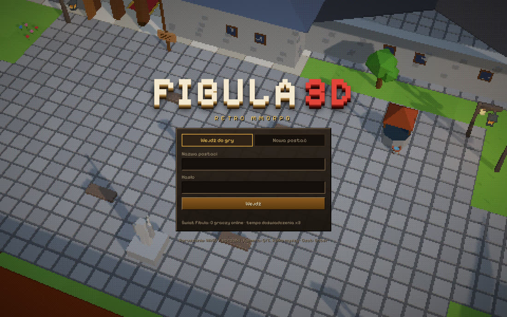
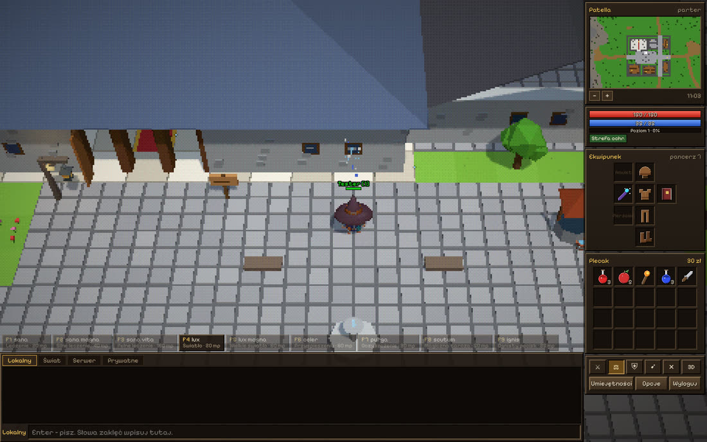
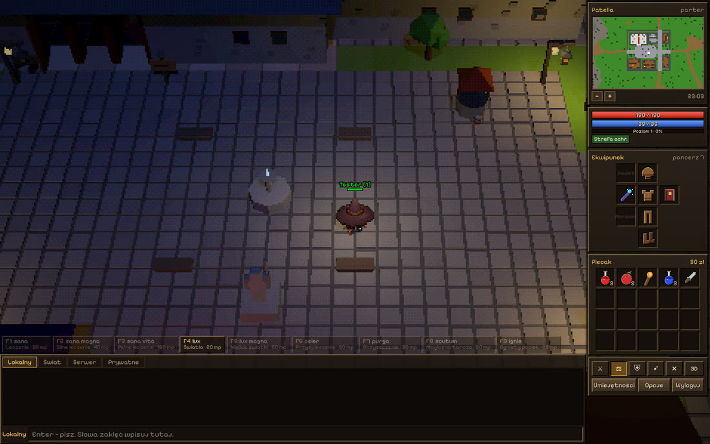
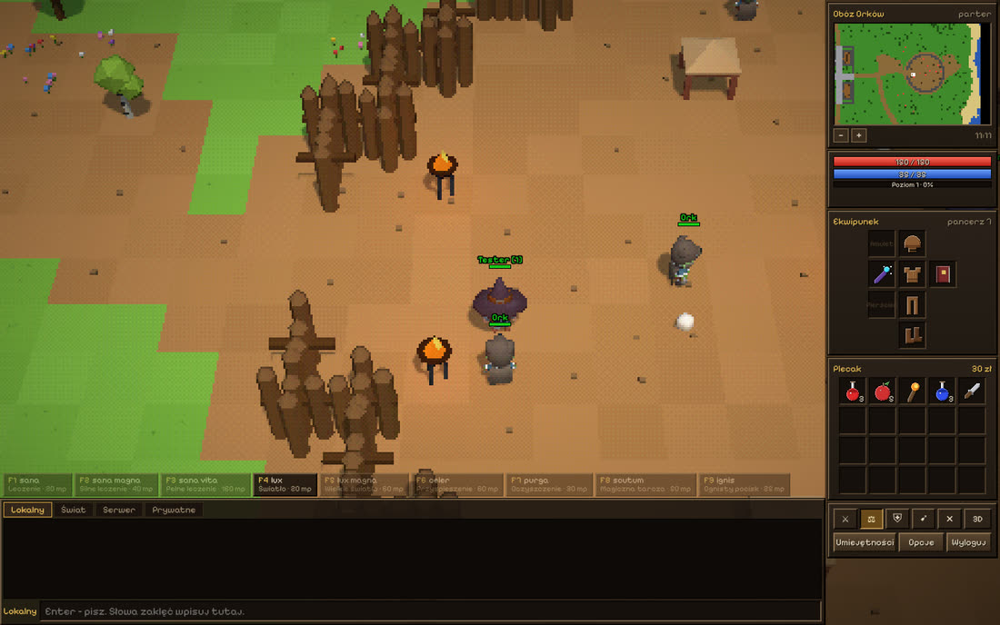
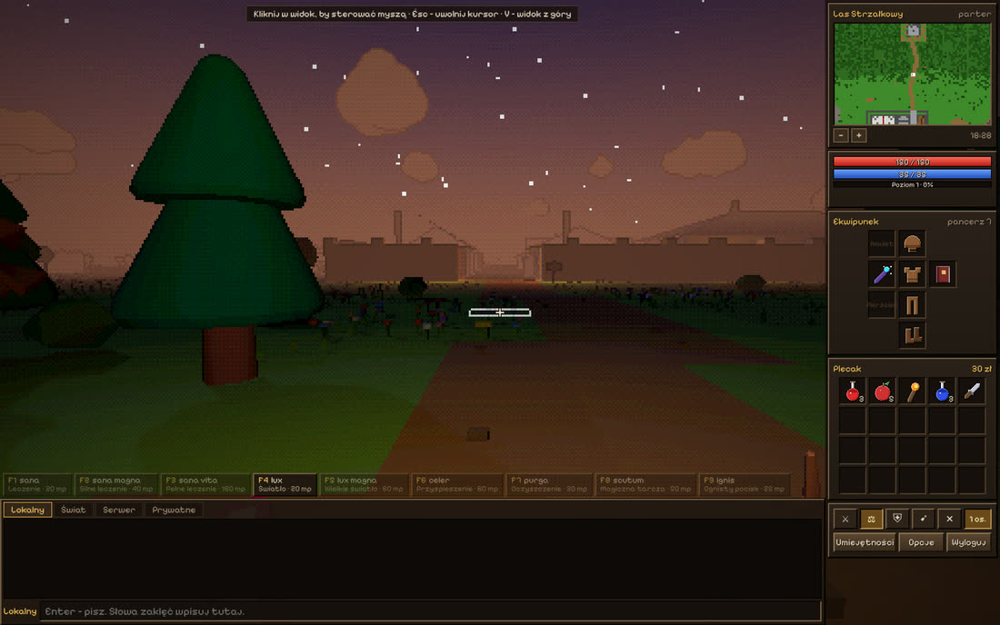
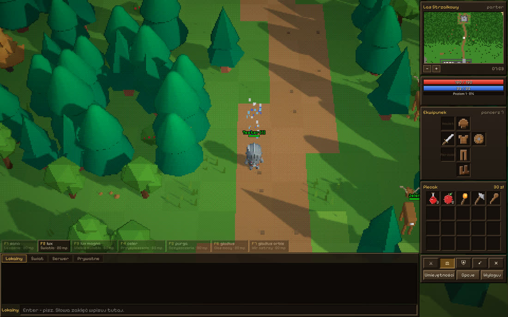
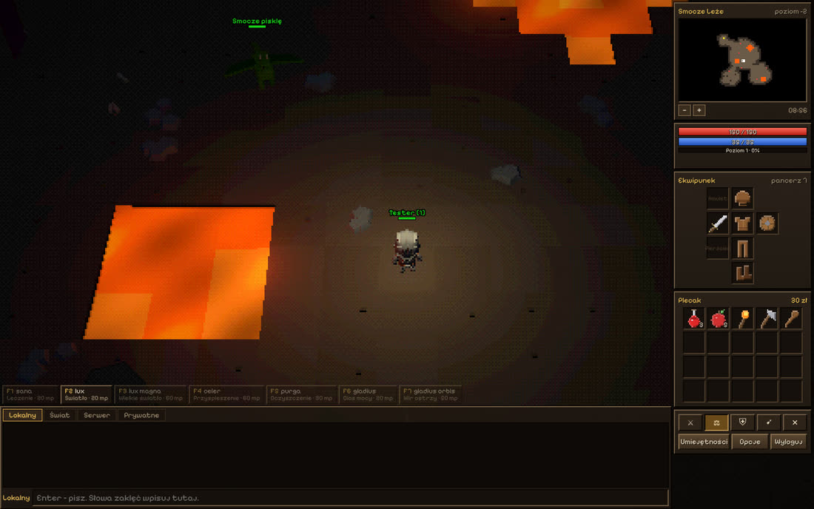

# Fibula 3D

Retro MMORPG 3D w przeglądarce, inspirowany klasyczną erą kafelkowych gier online (7.x).
Autorytatywny serwer w Node.js, klient w Three.js z pikselowym post-procesem, polski interfejs,
widok z góry lub z perspektywy pierwszej osoby.



| Patella za dnia | Patella nocą |
| --- | --- |
|  |  |
| **Obóz orków** | **Widok pierwszej osoby (zmierzch)** |
|  |  |
| **Las Strzałkowy** | **Smocze Leże** |
|  |  |

## Windows: gotowa paczka

Pobierz **[Fibula3D-Windows.zip](https://github.com/tengrajewski-a11y/monitoring/releases/download/fibula-3d-windows/Fibula3D-Windows.zip)**,
rozpakuj (prawy przycisk → „Wyodrębnij wszystkie…”) i kliknij dwukrotnie **`Fibula 3D.cmd`**.
Otworzy się okno serwera i przeglądarka z grą. Node.js jest w paczce, nic nie trzeba instalować.
`Fibula 3D - serwer LAN.cmd` uruchamia grę dla znajomych w tej samej sieci. Szczegóły w `CZYTAJ.txt`
w paczce.

Paczkę buduje i testuje na Windows workflow `.github/workflows/fibula-3d-windows.yml`
(`tools/package-windows.mjs` + oficjalny Node.js ze sprawdzeniem sumy SHA-256).

## Szybki start (ze źródeł)

Wymagany Node.js 20+.

```bash
cd fibula-3d
npm install
npm start
```

Otwórz <http://localhost:7172>, załóż postać (nazwa + hasło + profesja) i graj. Kilka kart
przeglądarki = kilku graczy w tym samym świecie.

`npm test` uruchamia testy (formuły, spójność mapy, testy integracyjne serwera przez WebSocket).

## Sterowanie

| Klawisz / mysz | Działanie |
| --- | --- |
| WASD / strzałki | ruch po kafelkach (względem kamery) |
| 7 9 1 3 (num) | ruch po skosie |
| Ctrl + strzałka | obrót postaci |
| Q / E, kółko myszy | obrót i zoom kamery |
| **V** | **przełącznik widoku: z góry ↔ pierwsza osoba** |
| LPM | idź / atakuj / rozmawiaj z NPC / otwórz zwłoki |
| PPM | menu kontekstowe (Zobacz, Podnieś, Użyj, Handel…) |
| Shift + LPM | zobacz |
| Enter | czat, Esc – anuluj cel / zamknij okna |
| F1–F9 | zaklęcia z paska (słowa można też wpisać na czacie) |

W trybie pierwszej osoby kliknij widok, by przechwycić mysz (rozglądanie), WASD chodzi względem
kierunku patrzenia, a LPM działa na to, co jest pod celownikiem. Esc uwalnia kursor.

## Świat Fibuli

Wyspa w kształcie kości z miastem **Patella** (świątynia, kuźnia, chata myśliwego, ziołownia,
karczma), **Lasem Strzałkowym** z ruinami strażnicy, **Górami Żebrowymi** z **Jaskiniami
Kręgowymi**, **Bagnami Kulszowymi**, **Równinami Rzepkowymi** z obozem orków, **Starym Cmentarzem**
z kryptą Kościeja i **Smoczym Leżem** dwa poziomy pod ziemią. 22 rodzaje potworów, 7 NPC
z dialogami na słowa kluczowe i sklepami, 3 skrzynie questowe, cykl dnia i nocy.

Profesje: **rycerz**, **paladyn**, **czarnoksiężnik**, **druid**. Zaklęcia rzuca się, wpisując
łacińskie inkantacje, np. `sana` (leczenie), `lux` (światło), `ignis` (ognisty pocisk),
`fulmen` (promień energii), `gladius orbis` (wir ostrzy), `sagitta` (święta strzała).
Pełna lista pod `zaklęcia` u Ojca Ignacego.

Rozmowa z NPC: `witaj`, potem słowa z nawiasów (klikalne w czacie), `handel` otwiera sklep,
`żegnaj` kończy rozmowę. Komendy: `/pomoc`, `/online`, `/w Imię, wiadomość`, `/czas`.

## Mechanika: co zostało przeniesione z silnika 7.72

Na podstawie analizy przesłanego, zdekompilowanego serwera (C++) odtworzone zostały **reguły gry**,
zaimplementowane od nowa w JavaScript (bez kopiowania kodu ani danych):

- krzywa doświadczenia `(((L − 6)·L + 17)·L − 12) / 6 · 100` (`TSkillLevel::GetExpForLevel`),
- postęp umiejętności jako szereg geometryczny z mnożnikami profesji (`TSkillProbe`, `SetProfession`),
- obrażenia wręcz: losowanie ataku i obrony `ProbeValue`, tryby ofensywny/defensywny, pancerz
  `armor/2 + rand(armor/2)` (`TCombat`),
- trafienia dystansowe z trudnością zależną od odległości, różdżki z kosztem many,
- obrażenia czarów `(baza ± wariancja) · (poziom·2 + mlvl·3) / 100` (`ComputeDamage`),
- szybkość `2·GoStrength + 80`, czas kroku z „waypoints” podłoża i 3× wolniejszym skosem,
  kwantyzacja do 50 ms (`TCreature::NotifyGo`),
- regeneracja z jedzenia zależna od profesji (`TSkillFed::Event`),
- podział doświadczenia według zadanych obrażeń, PvP z połową obrażeń, białe/czerwone czaszki,
  blokada wylogowania w walce, utrata doświadczenia po śmierci,
- AI potworów: zdobywanie i gubienie celu, pościg, utrzymywanie dystansu, ucieczka przy niskim
  życiu, czary, powrót w okolice spawnu.

Świat, potwory, przedmioty, NPC, teksty, muzyka i grafika są oryginalne dla Fibuli.

## Konfiguracja

Skopiuj `config.example.json` do `config.json` i zmień, co chcesz (port, tempo doświadczenia,
PvP, długość doby, lista GM). Zmienne środowiskowe: `PORT`, `HOST`, `DATA_DIR`, `GMS`.
Postacie zapisują się w `data/players/*.json` (hasła jako scrypt).

GM (nazwy z `gms`) mają komendy: `/tp x y z`, `/czas <godzina>`, `/idz <imię>`, `/m <potwór> [n]`,
`/i <przedmiot> [n]`, `/lvl <n>`, `/lecz`, `/god`, `/ogloszenie <tekst>`, `/kick <imię>`.

## Wdrożenie na VPS

```bash
cd fibula-3d && npm ci --omit=dev
pm2 start ecosystem.config.cjs
```

Za nginx pamiętaj o WebSocketach:

```nginx
location / {
    proxy_pass http://127.0.0.1:7172;
    proxy_http_version 1.1;
    proxy_set_header Upgrade $http_upgrade;
    proxy_set_header Connection "upgrade";
    proxy_set_header X-Forwarded-For $remote_addr;
}
```

## Grafika, dźwięk i własne modele

- **Modele 3D**: paczki KayKit (CC0) przetworzone skryptem `npm run build:assets`
  (`KAYKIT_DIR=/ścieżka/do/sklonowanych/paczek`) do kilku plików GLB w `client/assets/models`.
  Orkowie, trolle i rozbójnicy to przemalowane w locie modele KayKit; zwierzęta, pająki,
  szlamy i smoki są modelowane proceduralnie.
- **Ikony przedmiotów**: generowane kodem (32×32, czarny kontur, cieniowanie 4 tonami).
  Podgląd: <http://localhost:7172/dev/icons.html>, modele: <http://localhost:7172/dev/models.html>.
- **Muzyka i efekty**: oryginalne utwory i dźwięki z syntezatora offline (`tools/synth.mjs`,
  `npm run build:audio`, wymaga ffmpeg) + dźwięki CC0 z zestawów Kenney. Pliki można podmienić,
  edytując `client/assets/audio/manifest.json`.
- **Własne modele stworzeń z AI**: `tools/local_generate.py` (TripoSR lub TRELLIS.2, lokalnie
  na własnym GPU, licencja MIT) albo `tools/meshy_generate.py` (Meshy AI, płatne API). Wygenerowany
  GLB trafia do `client/assets/models/custom/` i automatycznie zastępuje wybrany typ potwora.

### TripoSR krok po kroku

Wymaga Pythona 3.10+, ok. 6 GB VRAM (karta NVIDIA) albo cierpliwości na CPU (kilka minut
na model). Przy pierwszym uruchomieniu pobierane są wagi (~1,7 GB) z Hugging Face.

```bash
git clone https://github.com/VAST-AI-Research/TripoSR ~/TripoSR
python -m venv ~/tsr-venv && source ~/tsr-venv/bin/activate   # Windows: ~\tsr-venv\Scripts\activate
pip install torch            # z kartą NVIDIA: polecenie z CUDA ze strony pytorch.org
pip install omegaconf einops transformers trimesh huggingface-hub "rembg[cpu]" PyMCubes fast-simplification
python tools/local_generate.py wolf obrazki/wilk.png --repo ~/TripoSR --height 0.8
```

Pierwszy argument to typ potwora z `server/data/monsters.js` (`rat`, `wolf`, `orc`, `dragon`…).
Najlepiej działa czysty obrazek jednego stwora na jednolitym tle, w widoku z przodu lub 3/4.
`--faces` ustawia liczbę trójkątów (domyślnie 8000, mniej = bardziej retro), `--rot` obraca
model, jeśli patrzy w złą stronę. Odśwież grę, żeby zobaczyć nowy model. Kompilacja
`torchmcubes` z `requirements.txt` TripoSR nie jest potrzebna – skrypt używa wtedy PyMCubes.

Szczegóły licencji: [CREDITS.md](CREDITS.md).

## Struktura

```text
fibula-3d/
├── server/        serwer gry (świat, walka, czary, AI, NPC, zapis postaci, generator mapy)
├── shared/        kod wspólny: stałe, formuły, przedmioty, mapa, A*
├── client/        klient: index.html, css, js (render, UI, audio), assets
├── tools/         potoki assetów, syntezator muzyki, generatory modeli AI
├── test/          testy node:test
└── docs/          zrzuty ekranu
```

„Tibia” jest znakiem towarowym CipSoft GmbH. Fibula 3D jest niezależnym projektem i nie zawiera
kodu, grafik, map ani danych CipSoft.
